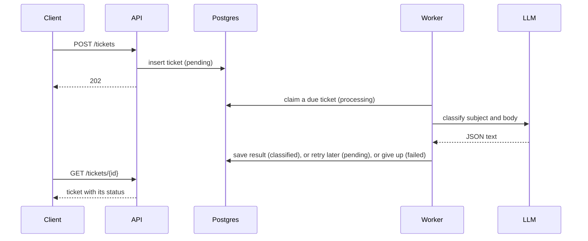

<div align="center">
  

  <h1>Ticket Classification Service</h1>

  <p>
    An HTTP service that classifies support tickets with an LLM in the background:
    a category, a priority and a one-sentence summary for each ticket.
  </p>

  <p>
    
    
    
    
    
  </p>
</div>

## About

The system runs as three services in Docker Compose: the API, Postgres (data store and queue), and the workers. The API and the workers scale independently.

- **Submit:** `POST /tickets` stores a ticket and returns right away.
- **Classify:** workers ask the model for a category, a priority and a summary, and retry failures.
- **Read:** get or list tickets through the API or the web client at `/`.

## Tech stack

| Area           | Tools                                                         |
| -------------- | ------------------------------------------------------------- |
| API            | Python 3.13 (asyncio), FastAPI, Pydantic                      |
| Data and queue | PostgreSQL 16, psycopg 3                                      |
| LLM            | OpenAI SDK, any OpenAI-compatible API (OpenRouter by default) |
| Web client     | One HTML page with Tailwind CSS                               |
| Tooling        | Docker Compose, uv, pytest                                    |

## Installation

You need Docker and `uv`.

1. Create `.env`.
   ```sh
   cp .env.example .env
   ```

2. Build and start the services.
   ```sh
   docker compose up -d --build --wait
   ```

> [!NOTE]
> The system works with a built-in fake LLM model. To use a real model, set `LLM_PROVIDER=openai_compat`, `LLM_API_KEY`, `LLM_MODEL` and `LLM_BASE_URL` in `.env` for any OpenAI-compatible API.

## Usage

1. Seed the database.
   ```sh
   docker compose exec api python scripts/load_samples.py
   ```

2. Open the web client at http://localhost:8000.

3. Browse the API docs at http://localhost:8000/docs.

4. Submit a new ticket.
   ```sh
   curl -X POST localhost:8000/tickets -H 'Content-Type: application/json' \
     -d '{"id": "t-2001", "subject": "Refund", "body": "I was charged twice for May."}'
   ```

5. Get a ticket.
   ```sh
   curl localhost:8000/tickets/t-2001
   ```

6. List and filter tickets.
   ```sh
   curl 'localhost:8000/tickets?category=billing&limit=5'
   ```

7. Review logs.
   ```sh
   docker compose logs -f api worker
   ```

8. Add more workers. Each worker processes `WORKER_CONCURRENCY` tickets at a time.
   ```sh
   docker compose up -d --scale worker=3
   ```

9. Stop the services.
   ```sh
   docker compose down
   ```

### Tests

Tests use the Compose Postgres server, with a separate database `tickets_test`.
```sh
docker compose up -d --wait db
uv run pytest
```

### Evaluation

`samples/evaluation_set.json` holds labelled tickets, including prompt-injection attempts. This script classifies them with the model configured in `.env` and reports how many labels it got right.
```sh
uv run python -m scripts.evaluate
```
Each run also saves one JSON line per ticket to `logs/evaluations/`, which git ignores.

## How it works



- `app/api.py` is the API service.
- `app/static/index.html` is the web client served at `/`. It only calls the JSON API.
- `app/worker.py` is the worker that classifies tickets.
- `app/data/` has the schema and all SQL.
- `app/llm/` has the model clients, the prompt, and the prompt-injection guard.

## Design decisions

### Postgres vs RabbitMQ or Kafka

RabbitMQ or Kafka are reasonable alternatives for this queue. However, a ticket must be queryable with `status = 'pending'` as soon as it is submitted, and duplicate ids must be rejected. A broker cannot do either easily, so we would store the ticket in a durable store first anyway and then publish it to RabbitMQ or Kafka. That adds extra synchronization for little gain. Postgres already has the primitives a queue needs: `run_after` for scheduling, `locked_until` for leases, and `SELECT ... FOR UPDATE SKIP LOCKED` for claiming, so one store does both jobs.

### Prompt injection

Ticket content comes from the public, so we cannot fully protect the model from prompt injection. We follow common practices to make it harder, and keep an evaluation set to measure how a model actually behaves:

1. The system prompt says the ticket is untrusted data to classify, never instructions for the model.
2. The ticket is wrapped in `<ticket>` tags, and any similar tag inside it is removed first (`app/llm/guard.py`), so the ticket cannot close its own block.

Neither step removes the risk. What limits the damage is the model boundary below: whatever the model is told, it can only store one of the allowed categories and priorities and a short summary.

### Model boundary

The worker treats the model's reply as untrusted text. It asks for JSON that matches a strict schema, but it does not rely on the provider to enforce it: our code validates the reply itself. Labels must be in the allowed sets, the summary must be short, and unknown or missing fields are rejected. An invalid reply stores nothing and counts as a failed attempt.

There is no failover between LLM providers in the code. OpenRouter, the default endpoint, already routes around failing providers. With a single provider instead, failover would need a list of providers to try in turn.

## Ticket lifecycle

The `tickets` table holds the ticket data and is also the job queue. Creating a ticket and queueing it is one `INSERT`, so the two can never disagree.

Because Postgres is the only store, the same id is never stored twice. Submitting the same ticket again returns `200` with the stored ticket. The same id with different content returns `409`.

A ticket's status moves through:

- `pending`: waiting to be claimed, once `run_after` has passed.
- `processing`: a worker claimed it and holds a lease until `locked_until`.
- `classified`: done, with a validated result.
- `failed`: all `MAX_ATTEMPTS` attempts are used, with the reason in `last_error`.

Workers claim tickets with `SELECT ... FOR UPDATE SKIP LOCKED`. Each worker locks the next free row and skips rows other workers have locked, so workers never wait on each other or take the same ticket.

When an attempt fails, the worker sets the ticket back to `pending` with a later `run_after`.

A worker that crashes or is killed cannot do that, so its ticket stays `processing`, but its lease ends at `locked_until` and the ticket becomes claimable again. This allows another worker to claim the ticket and process it again. Workers query for these tickets as well as new `pending` tickets, so we don't need a separate cleanup job.

**What if a worker takes too long and another worker claims its ticket?** Each claim adds 1 to `attempts`. A worker can only store its result if `attempts` still matches the value from its own claim. So only the worker with the latest claim gets to store the result, even if the first worker finishes earlier.

Retries:

- Every failure is retried: timeouts, rate limits, provider errors and invalid replies.
- The wait is 5 × 2^attempts seconds, randomly scaled by ±20%, at least the provider's `Retry-After`, and at most 300 seconds.
- After `MAX_ATTEMPTS` (3), the ticket is `failed`. If the lease expired on the last attempt, it is marked `failed` without calling the model again.

### Graceful shutdown

On SIGTERM, each worker finishes its current ticket and exits. A model call is cut off after `LLM_TIMEOUT_SECONDS`, and Compose reads its stop grace period from the same variable, so a stopping worker always has time to finish. If a worker is killed anyway, its lease expires and another worker can pick the ticket up.

## Scalability

This is a prototype and is not ready for production. This is how we expect it to scale, and what we might change as the load grows:

- **API:** it keeps no state, so several copies could run behind a load balancer.
- **Workers:** they scale on their own, with more containers (`--scale worker=N`) or a higher `WORKER_CONCURRENCY`. Postgres gives each ticket to one worker, so the workers need no other coordination.
- **Model provider:** its rate limit is likely the real ceiling. We might spread calls over several providers or API keys, behind the same `Classifier` interface.
- **Postgres:** at high volume, the frequent queue updates would compete with reads of the same rows. We might move the job state (lease, attempts, `run_after`) into its own table, and wake workers with `LISTEN/NOTIFY` instead of polling.

## Future features

These are some of the features we could add next.

- **Metrics:** queue depth, outcomes per attempt and model latency would show whether the workers keep up and how the model behaves. We could start by querying the database for the number of tickets in each status, and move to Prometheus as the system grows.
- **Reviewing failed tickets:** `failed` tickets work like a dead-letter queue (`GET /tickets?status=failed`). Reviewing them by hand could reveal regressions in the prompt or the model. A way to re-queue them after a fix would be a natural next step.
- **Reclassifying after prompt changes:** each result stores its `prompt_version`. After a prompt change, we could re-queue tickets classified by an older version and compare the results.
- **Schema migrations:** `schema.sql` only runs when the database is first created. A migration tool would be needed before the schema can change on a live database.
