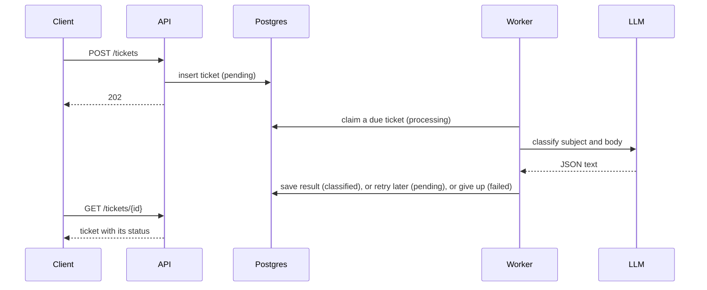

# Ticket Classification Service

An HTTP service that takes support tickets, classifies each one with an LLM in the background (category, priority and a one-sentence summary), and serves the results.

It runs as three services in Docker Compose: the API, Postgres (data store and queue), and the workers. The API and the workers scale independently.

The system is built using:
- Python 3.13 (asyncio)
- PostgreSQL 16
- FastAPI
- psycopg 3
- OpenAI SDK
- Docker Compose and uv

## Installation

You need Docker and `uv`.

1. Create `.env`.
   ```sh
   cp .env.example .env
   ```

2. Build and start the services.
   ```sh
   docker compose up -d --build --wait
   ```

> [!NOTE]
> The system works with a built-in fake LLM model. To use a real model, set `LLM_PROVIDER=openai_compat`, `LLM_API_KEY`, `LLM_MODEL` and `LLM_BASE_URL` in `.env` for any OpenAI-compatible API.

## Usage

1. Seed the database.
   ```sh
   docker compose exec api python scripts/load_samples.py
   ```

2. Browse the API docs at http://localhost:8000/docs. The OpenAPI schema is at http://localhost:8000/openapi.json.

3. Submit a new ticket.
   ```sh
   curl -X POST localhost:8000/tickets -H 'Content-Type: application/json' \
     -d '{"id": "t-2001", "subject": "Refund", "body": "I was charged twice for May."}'
   ```

4. Get a ticket.
   ```sh
   curl localhost:8000/tickets/t-2001
   ```

5. List and filter tickets.
   ```sh
   curl 'localhost:8000/tickets?category=billing&limit=5'
   ```

6. Review logs.
   ```sh
   docker compose logs -f api worker
   ```

7. Add more workers. Each worker processes `WORKER_CONCURRENCY` tickets at a time.
   ```sh
   docker compose up -d --scale worker=3
   ```

8. Stop the services.
   ```sh
   docker compose down
   ```

### Tests

Tests use the Compose Postgres server, with a separate database `tickets_test`.
```sh
docker compose up -d --wait db
uv run pytest
```

### Evaluation

`samples/evaluation_set.json` holds labelled tickets, including prompt-injection attempts. This script classifies them with the model configured in `.env` and reports how many labels it got right.
```sh
docker compose exec worker python -m scripts.evaluate
```

## How it works



- `app/api.py` is the API service.
- `app/worker.py` is the worker that classifies tickets.
- `app/data/` has the schema and all SQL.
- `app/llm/` has the model clients, the prompt, and the prompt-injection guard.

## System Assumptions and Design Decisions

### Postgres vs RabbitMQ or Kafka

RabbitMQ or Kafka are reasonable choices for a queue, but a ticket must be readable as soon as it is submitted, while it is still `pending`, and duplicate ids must be rejected. Both need a queryable data store anyway. With a broker, the API would have to check both the broker and Postgres and keep them in sync, which adds complexity for no gain. Postgres already has the primitives a queue needs: `run_after` for scheduling, `locked_until` for leases, and `SELECT ... FOR UPDATE SKIP LOCKED` for claiming, so one store does both jobs.

### Prompt injection

Ticket content comes from the public, so we cannot fully protect the model from prompt injection. We follow common practices to make it harder, and keep an evaluation set to measure how a model actually behaves:

1. The system prompt says the ticket is untrusted data to classify, never instructions for the model.
2. The ticket is wrapped in `<ticket>` tags, and any similar tag inside it is removed first (`app/llm/guard.py`), so the ticket cannot close its own block.

Neither step removes the risk. What limits the damage is the model boundary below: whatever the model is told, it can only store one of the allowed categories and priorities and a short summary.

### Model boundary

The worker treats the model's reply as untrusted text. It asks for JSON matching a strict schema, but does not rely on the provider to enforce it: our code validates the reply itself. Labels must be in the allowed sets, the summary must be short, and unknown or missing fields are rejected. An invalid reply stores nothing and counts as a failed attempt. Error messages never include the model's output. The SDK's own retries are off, so every retry goes through the worker and is counted.

There is no failover between LLM providers in the code. OpenRouter, the default endpoint, already routes around failing providers. Without it, the classifier would need a list of providers to try in turn.

## Ticket Lifecycle

The `tickets` table holds the ticket data and is also the job queue. Creating a ticket and queueing it is one `INSERT`, so the two can never disagree. Because Postgres is the only store, the same id is never stored twice: submitting the same ticket again returns `200` with the stored ticket, and the same id with different content returns `409`.

A ticket's status moves through:

- `pending`: waiting to be claimed, once `run_after` has passed.
- `processing`: a worker claimed it and holds a lease until `locked_until`.
- `classified`: done, with a validated result.
- `failed`: all `MAX_ATTEMPTS` attempts are used, with the reason in `last_error`.

Workers claim tickets with `SELECT ... FOR UPDATE SKIP LOCKED`. Each worker locks the next free row and skips rows other workers have locked, so workers never wait on each other or take the same ticket.

A `processing` ticket becomes claimable again once `locked_until` passes. This covers a worker that crashed or was killed. A failed attempt goes back to `pending` with a later `run_after`. Every claim adds 1 to `attempts`, and a worker can only store a result if `attempts` still matches its claim, so a worker that returns after its lease expired cannot overwrite the new one.

Retries:

- Every failure is retried: timeouts, rate limits, provider errors and invalid replies.
- The wait is 5 × 2^attempts seconds, randomly scaled by ±20%, at least the provider's `Retry-After`, and at most 300 seconds.
- After `MAX_ATTEMPTS` (3), the ticket is `failed`. If the lease expired on the last attempt, it is marked `failed` without calling the model again.

### Graceful shutdown

On SIGTERM, each worker finishes its current ticket and exits. Compose waits up to 45 seconds (`stop_grace_period`), which is longer than the 30-second model timeout. If you raise `LLM_TIMEOUT_SECONDS`, raise the grace period too.

## Scalability

- The API keeps no state, so it can run as many replicas as needed behind a load balancer.
- Workers scale separately, with `--scale worker=N` and `WORKER_CONCURRENCY`.
- The model provider's rate limit is the real ceiling. A load-balancing or failover classifier can be added behind the same `Classifier` interface.
- At larger scale, move job state (lease, attempts, `run_after`) into its own table so frequent queue updates don't touch the ticket rows, and use `LISTEN/NOTIFY` instead of polling.

## With more time

- Metrics: queue depth, outcomes per attempt, model latency.
- `failed` tickets act as a dead-letter queue (`GET /tickets?status=failed`). They can be reviewed by hand to find regressions in the prompt or the model, then re-queued.
- Reclassify tickets with an old `prompt_version`.
- Schema migrations. The service only applies `schema.sql` on a fresh database and has no way to migrate an existing one.
